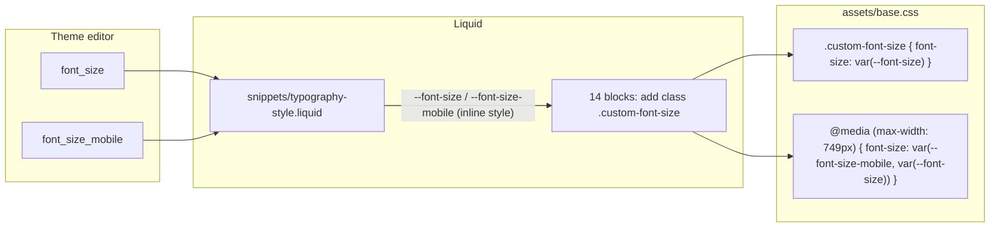

# Mobile Font Size (`font_size_mobile`)

Adds a second font-size control to every Horizon block that already exposes a font size, so a merchant can
pick one size for desktop and a different one for mobile (viewports ≤749px) from the theme editor, without
custom CSS. It lives in the **Custom** typography preset of 14 text blocks (text, headings, product
title/description/price/SKU, collection title, blog titles/description, announcement bar, footer copyright
and policy list) and, as `type_font_primary_size_mobile`, in the header menu block (top-level items of the
mobile drawer). The default (`Default` / empty) keeps the current behaviour on mobile, so existing stores
render exactly as stock Horizon until someone configures it.

---

## Architecture



## File Structure

| File | Action | Purpose |
|------|--------|---------|
| `snippets/typography-style.liquid` | Modified | Emits `--font-size-mobile` when `settings.font_size_mobile` is not blank (fixed value, no `clamp()`) |
| `assets/base.css` | Modified | Mobile media query on `.custom-font-size` consuming `--font-size-mobile` with fallback to `--font-size` |
| `snippets/text.liquid` | Modified | `custom-font-size` class also added when only the mobile size is set |
| `blocks/text.liquid` | Modified | `font_size_mobile` setting |
| `blocks/_heading.liquid` | Modified | `font_size_mobile` setting |
| `blocks/product-title.liquid` | Modified | `font_size_mobile` setting |
| `blocks/product-description.liquid` | Modified | `font_size_mobile` setting |
| `blocks/collection-title.liquid` | Modified | `font_size_mobile` setting |
| `blocks/_product-list-text.liquid` | Modified | `font_size_mobile` setting |
| `blocks/_blog-post-title.liquid` | Modified | `font_size_mobile` setting |
| `blocks/_featured-blog-posts-title.liquid` | Modified | `font_size_mobile` setting |
| `blocks/price.liquid` | Modified | `font_size_mobile` setting + class condition |
| `blocks/sku.liquid` | Modified | `font_size_mobile` setting + class condition |
| `blocks/_announcement.liquid` | Modified | `font_size_mobile` setting + class condition |
| `blocks/_blog-post-description.liquid` | Modified | `font_size_mobile` setting + class condition |
| `blocks/footer-copyright.liquid` | Modified | `font_size_mobile` setting (with extra `Default` option) + class condition |
| `blocks/footer-policy-list.liquid` | Modified | `font_size_mobile` setting (with extra `Default` option) + class condition + mobile override of its own `.policy-list-trigger` rule |
| `blocks/_header-menu.liquid` | Modified | `type_font_primary_size_mobile` setting (top-level menu items on mobile) |
| `snippets/menu-font-styles.liquid` | Modified | Emits `--menu-top-level-font-size-mobile` when the setting is not blank |
| `snippets/header-drawer.liquid` | Modified | Nested `@media (max-width: 749px)` on `.menu-drawer__menu-item--mainlist` (menu) and on the drawer localization rules (`.language-selector`, flag, button label); adds the localization mobile variable to the drawer `form_style` |
| `sections/header.liquid` | Modified | `localization_font_size_mobile` setting; emits `--menu-localization-font-size-mobile` next to the desktop variable |
| `blocks/menu.liquid` | Modified | `heading_size` / `heading_size_mobile` + `link_size` / `link_size_mobile` settings (footer menu); inline variables, modifier classes, desktop rules and 749px rules |

No locale files were changed: the setting reuses the existing keys `t:settings.size_mobile` ("Mobile size")
and `t:options.default` ("Default"), present in all 57 `locales/*.schema.json`.

## Data Flow

```mermaid
sequenceDiagram
    participant ED as Theme editor
    participant BL as Block (e.g. blocks/text.liquid)
    participant TS as typography-style.liquid
    participant CSS as base.css

    ED->>BL: type_preset = custom, font_size, font_size_mobile
    BL->>BL: add .custom-font-size if font_size != "" or font_size_mobile != blank
    BL->>TS: render 'typography-style', settings: block.settings
    TS-->>BL: style="--font-size: 1.5rem; --font-size-mobile: 1rem; …"
    BL->>CSS: desktop: font-size: var(--font-size)
    BL->>CSS: ≤749px: font-size: var(--font-size-mobile, var(--font-size))
```

## Implementation Details

### Liquid Components

#### Snippet: `typography-style`

**File:** `snippets/typography-style.liquid`

Single conversion point from typography settings to inline CSS custom properties. Inside the
`preset == 'custom'` branch, right after the block that emits `--font-size`, it now emits the mobile
value when present:

```liquid

  --font-size-mobile: {{ settings.font_size_mobile }};

```

The mobile value is written as-is (fixed `rem`). The desktop `clamp()` logic for sizes ≥3rem is not
applied to it: the whole point of the setting is an exact designer-chosen size on small screens.

**Parameters:** unchanged (`settings`, optional `type`, optional `preset`). `settings.font_size_mobile` is
read like any other typography setting.

#### Blocks (14)

Each block adds one `select` setting immediately after its `font_size` setting, with the same options,
`"default": ""` and the same `visible_if` as `font_size` in that block:

| Block | Options | `visible_if` |
|-------|---------|--------------|
| `text`, `_heading`, `product-title`, `product-description`, `collection-title`, `_product-list-text`, `_blog-post-title`, `_featured-blog-posts-title`, `price`, `sku`, `_blog-post-description` | 17 (Default, 10px … 184px) | `type_preset == 'custom'` |
| `_announcement` | 17 (Default, 10px … 184px) | none (block has no `type_preset`) |
| `footer-copyright`, `footer-policy-list` | 6: **Default** (added) + 10px … 18px | none |

The footer blocks' original `font_size` has no empty option (default `0.75rem`), so the mobile select
prepends `{"value": "", "label": "t:options.default"}` to make "same as desktop" selectable.

**Class condition.** Horizon only applies `.custom-font-size` when `font_size != ""`. The condition was
widened in the 7 places that add the class (`snippets/text.liquid`, `price`, `sku`, `_announcement`,
`_blog-post-description`, `footer-copyright`, `footer-policy-list`) to:

```liquid
custom-font-size
```

`blank` (not `""`) is deliberate for the new setting: in Liquid `nil != ""` is **true**, so `!= ""` would
have applied the class to every instance of a block whose schema did not (yet) declare the setting.

**Settings (identical in all 14 blocks):**

| Setting | Type | Default | Description |
|---------|------|---------|-------------|
| `font_size_mobile` | `select` | `""` (Default) | Font size applied at viewports ≤749px when the block uses the Custom preset. Empty inherits the desktop `font_size`. |

#### Block-specific CSS: `footer-policy-list`

**File:** `blocks/footer-policy-list.liquid` (``)

This block does not size its text through `.custom-font-size`: the trigger button has its own rule
`.policy-list-trigger { font-size: var(--font-size, 0.75rem); }`. The feature adds the matching mobile
override in the same stylesheet:

```css
@media screen and (max-width: 749px) {
  .policy-list-trigger {
    font-size: var(--font-size-mobile, var(--font-size, 0.75rem));
  }
}
```

Known limitation (pre-existing in Horizon, unchanged here): the policy links inside the popover
(`.policy_list li a`) read `--font-size` too, but `typography-style` is only rendered on the trigger button
and the popover is a sibling element, so those links never receive `--font-size` **or** `--font-size-mobile`
and stay at 0.75rem. Neither the desktop nor the mobile setting affects them.

#### Block: header menu (`_header-menu`)

**File:** `blocks/_header-menu.liquid` (+ `snippets/menu-font-styles.liquid`, `snippets/header-drawer.liquid`)

The header menu does not use `typography-style`; it has its own size setting, `type_font_primary_size`
("Top level size", 10–18px). Stock Horizon applies it **only on desktop** (`.menu-list__link` reads
`--menu-top-level-font-size-desktop` at ≥750px). In the mobile drawer the top-level items use the fixed
token `--menu-font-2xl--size` (28px) and the setting has no effect.

The feature adds a sibling setting and one variable:

| Setting | Type | Default | Options | Description |
|---------|------|---------|---------|-------------|
| `type_font_primary_size_mobile` | `select` | `""` (Default = 28px token) | 14, 16, 18, 20, 24, 28, 32px | Font size of top-level drawer items at viewports ≤749px |

- `snippets/menu-font-styles.liquid` emits `--menu-top-level-font-size-mobile: <value>;` when the setting
  is not blank (both for the mega menu and the drawer render; only the drawer consumes it).
- `snippets/header-drawer.liquid` adds, nested inside `.menu-drawer__menu-item--mainlist` (the file's own
  media-query style): `@media screen and (max-width: 749px) { font-size: var(--menu-top-level-font-size-mobile, var(--menu-top-level-font-size)); }`.

Why a viewport media query and not "drawer = mobile": Horizon switches to the drawer by JavaScript
(`setHeaderMenuStyle()` in `assets/utilities.js`) on **touch devices and when the menu overflows**, so the
drawer can render at desktop widths. Keying the override on `max-width: 749px` guarantees desktop never
changes. The mega menu list is `display: none` below 750px, so it is unaffected. Line-height keeps the
token's unitless ratio and scales with the new size.

#### Section: header localization (`sections/header.liquid`)

The header section exposes `localization_font_size` (10–18px) for the country/language selector. Stock
Horizon applies it to the desktop dropdown only (`.dropdown-localization__button`, `mobile:hidden`); the
mobile drawer never received the variable, so its selector inherited its size (language-only variant) or
used the global `.h6` class (country variant).

| Setting | Type | Default | Options | Description |
|---------|------|---------|---------|-------------|
| `localization_font_size_mobile` | `select` | `""` (Default = current rendering) | 10, 12, 14, 16, 18px | Size of the localization selector in the drawer at viewports ≤749px |

- `sections/header.liquid` appends `--menu-localization-font-size-mobile: <value>;` to the existing
  `localization_font_size` string, so it reaches the dropdown `style` and `form_style` without touching
  those lines.
- `snippets/header-drawer.liquid` adds the same variable to the drawer `form_style` and consumes it in
  nested `@media screen and (max-width: 749px)` blocks on:
  - `.menu-drawer__localization:not(drawer-localization-component) .language-selector` (language-only variant),
  - `.drawer-localization__button .icon-flag` (flag size, fallback `--icon-size-sm`),
  - a new rule `.drawer-localization__button .drawer-localization__button--label.h6` with
    `font-size: var(--menu-localization-font-size-mobile, var(--font-h6--size))`. The extra specificity beats
    the global `.h6.h6` rule regardless of stylesheet order, and the fallback is the very token `.h6.h6`
    uses, so an unset setting computes to the identical value.

#### Block: footer menu (`menu`)

**File:** `blocks/menu.liquid` (used by `sections/footer.liquid`; two instances in `sections/footer-group.json`)

Stock Horizon gives this block no custom size at all: its heading and links take a **preset** (`heading_preset`,
`link_preset` → `paragraph`, `h1`…`h6`) applied as a global class, so the size comes from the global type
scale on every breakpoint. Four settings were added so the footer can be sized like a text block, without
touching the preset:

| Setting | Type | Default | Options | Description |
|---------|------|---------|---------|-------------|
| `heading_size` | `select` | `""` (Default = preset size) | 10, 12, 14, 16, 18, 20, 24, 28, 32, 40, 48px | Menu heading size (all breakpoints) |
| `heading_size_mobile` | `select` | `""` (Default = same as desktop) | same list | Menu heading size at ≤749px |
| `link_size` | `select` | `""` (Default = preset size) | same list | Menu link size (all breakpoints) |
| `link_size_mobile` | `select` | `""` (Default = same as desktop) | same list | Menu link size at ≤749px |

In the editor each group reads Preset → Size → Mobile size (labels reuse `t:settings.size` and
`t:settings.size_mobile`), mirroring the text blocks: Mobile size on Default inherits whatever desktop
renders, custom size or preset. Mechanism:

- The root `<details class="menu__details">` emits `--menu-heading-font-size`, `--menu-heading-font-size-mobile`,
  `--menu-link-font-size` and `--menu-link-font-size-mobile` inline, each only when its setting is not blank.
- The `<summary class="menu__heading">` gets `menu__heading--custom-size` / `menu__heading--mobile-size` and each
  `<li class="menu__item">` gets `menu__item--custom-size` / `menu__item--mobile-size`, only when the matching
  setting is set. Because the variables are consumed through modifier classes, an unset setting leaves no rule
  to apply — the preset class keeps full control.
- Desktop rules sit before the block's `@media screen and (max-width: 749px)` block:
  `.menu__details .menu__heading.menu__heading--custom-size, … > * { font-size: var(--menu-heading-font-size); }`
  (and the `.menu__item` pair). The mobile rules below have the same specificity and come later in the
  stylesheet, so at ≤749px a set mobile size wins over a set desktop size.
- Inside the block's existing `@media screen and (max-width: 749px)`:
  `.menu__details .menu__heading.menu__heading--mobile-size, .menu__details .menu__heading.menu__heading--mobile-size > * { font-size: var(--menu-heading-font-size-mobile); }`
  and the equivalent pair for `.menu__item`. The `> *` half is required: the global preset rule
  `.paragraph > *` (base.css) sizes the direct children too, so the `<a>` inside the `<li>` and the spans
  inside the `<summary>` would otherwise keep the preset size. Specificity (0,3,0) beats `.h3.h3`,
  `.paragraph:not(.button)` and `.paragraph > *` regardless of stylesheet order.

### CSS Classes

Existing class, no new class names.

| Class | Description |
|-------|-------------|
| `.custom-font-size`, `.custom-font-size > *` | Applies `font-size: var(--font-size)`; at ≤749px applies `font-size: var(--font-size-mobile, var(--font-size))` |

#### CSS Custom Properties

| Property | Description | Default |
|----------|-------------|---------|
| `--font-size` | Desktop size from `font_size` (fluid `clamp()` when ≥3rem) | unset |
| `--font-size-mobile` | Mobile size from `font_size_mobile`, fixed `rem` | unset → falls back to `--font-size` |

## Schema Settings

As added to `blocks/text.liquid` (other blocks are identical except for the differences in the table above):

```json
{
  "type": "select",
  "id": "font_size_mobile",
  "label": "t:settings.size_mobile",
  "options": [
    { "value": "", "label": "t:options.default" },
    { "value": "0.625rem", "label": "10px" },
    { "value": "0.75rem", "label": "12px" },
    { "value": "0.875rem", "label": "14px" },
    { "value": "1rem", "label": "16px" },
    { "value": "1.125rem", "label": "18px" },
    { "value": "1.25rem", "label": "20px" },
    { "value": "1.5rem", "label": "24px" },
    { "value": "2rem", "label": "32px" },
    { "value": "2.5rem", "label": "40px" },
    { "value": "3rem", "label": "48px" },
    { "value": "3.5rem", "label": "56px" },
    { "value": "4.5rem", "label": "72px" },
    { "value": "5.5rem", "label": "88px" },
    { "value": "7.5rem", "label": "120px" },
    { "value": "9.5rem", "label": "152px" },
    { "value": "11.5rem", "label": "184px" }
  ],
  "default": "",
  "visible_if": "{{ block.settings.type_preset == 'custom' }}"
}
```

## Accessibility

- **Semantic HTML:** unchanged; the setting only affects `font-size` on existing elements.
- **Minimum size:** the smallest selectable mobile size is 10px (`0.625rem`), the same floor Horizon already
  offers for desktop. Sizes below 16px on mobile hurt readability; the setting exposes the option, the
  merchant decides.
- **Line height / letter spacing:** `snippets/text.liquid` derives the typographic `type`
  (display/heading/body → line-height and letter-spacing tokens) from the **desktop** `font_size`. A
  mobile size does not change those tokens.
- **Keyboard / screen readers:** not affected.

## Sizing behaviour to keep in mind

- The mobile value is **fixed**, never fluid. Desktop sizes ≥48px are wrapped in `clamp()` so they shrink on
  narrow viewports; a mobile size is applied literally because its purpose is an exact designer-chosen
  value. The option list mirrors desktop on purpose (up to 184px), so a very large mobile size at 320–375px
  will overflow exactly like an oversized heading would. Pick the mobile size for the narrowest viewport
  the store supports.
- Sizes below 14px on mobile are allowed (the floor is 10px, same as desktop) but not recommended for body
  copy.

## Verification Checklist

- [ ] Stock page (no `font_size_mobile` set) renders identically before/after at 390, 768 and 1440 — no
      `--font-size-mobile` in the HTML, `.custom-font-size` count unchanged.
- [ ] Custom preset, desktop 24px + mobile 16px → 24px at 1440 and 768, 16px at 390.
- [ ] Custom preset, desktop **Default** + mobile 16px → 16px at 390; desktop unchanged vs. baseline
      (class present but `--font-size` unset, so it inherits like before).
- [ ] Footer copyright / policy list: mobile select shows **Default** first; leaving it renders as before.
- [ ] Footer policy list: the "Terms and policies" trigger changes size at 390 when a mobile size is set
      (the popover links do not — known limitation above).
- [ ] Largest mobile option (184px) on a text block at 375px: text wraps, page still usable, no console
      errors (overflow of a single long word is expected, as on desktop).
- [ ] Header menu: with `type_font_primary_size_mobile` unset the drawer's top-level items stay at 28px at 390;
      with 20px set they measure 20px at 390 and the desktop mega menu keeps `type_font_primary_size` at 1440.
- [ ] Footer menu: with all four size settings unset, heading and links keep their preset size at 390 and 1440;
      Size 18px / 16px → 18px / 16px at both widths; adding Mobile size 12px / 10px → 12px / 10px at 390 only.
- [ ] Header localization: with `localization_font_size_mobile` unset the drawer selector keeps its current size
      (12px `.h6` label in the country variant); with 10px set it measures 10px at 390 while the desktop
      dropdown keeps `localization_font_size` at 1440.
- [ ] The setting only appears under the **Custom** preset (except announcement and footer blocks, which
      have no preset).
- [ ] `shopify theme check` clean.

## Out of scope / known limits

- **Header actions** (`actions_font_size`): the text-style actions are `mobile:hidden` and the rule that
  reads `--header-actions-font-size` only exists at ≥750px, so a mobile size would have no effect. Not added.
- **Header menu "Submenu size"** (`menu_font_style`, small/medium/large by tokens) is shared by desktop and
  drawer; no mobile variant in this change (team decision).
- Blocks that expose only `type_preset` (accordion, review, popup-link, `_cart-title`,
  `_featured-product-price`, `_blog-post-info-text`) have no custom size and therefore no mobile size. The
  footer `menu` block is the one preset-only block that did get mobile sizes, by explicit team request.
- Tablet has no dedicated control; the single breakpoint is Horizon's 749px.
- `_inline-text` and `_inline-collection-title` reference `font_size` but do not declare it in their
  schema; they are untouched and unaffected.

## Upstream sync note

This is an agency customization on top of Shopify Horizon (see `CLAUDE.md → Agency customizations`).
When merging a new Horizon release, expect conflicts in the 14 block schemas (the new setting sits right
after `font_size`), `snippets/typography-style.liquid`, `snippets/text.liquid` and `assets/base.css`.
Re-apply the change on top of the upstream version.
